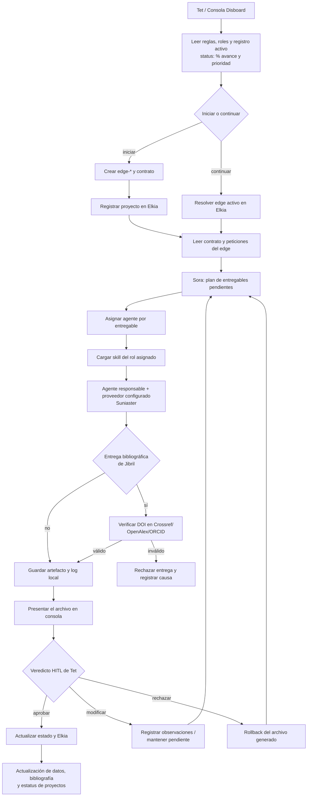
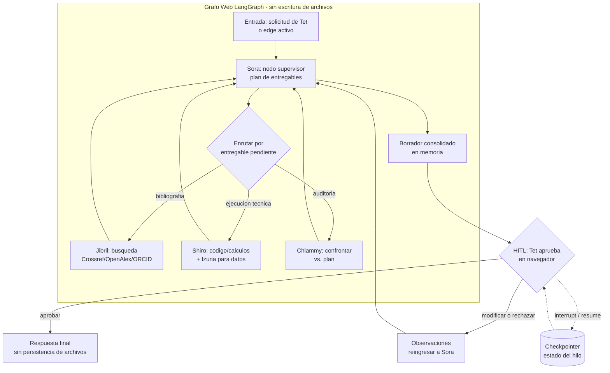

# Disboard-NGNL: Ecosistema Científico Multiagente en Suniaster

Bienvenido a **Disboard-NGNL**, un ecosistema local-first para coordinar proyectos de software, modelado científico y planificación mediante agentes. **Tet** dirige el trabajo y conserva la aprobación humana (**Human-in-the-loop, HITL**). El sistema está diseñado para ejecutarse en un equipo personal que actúa como núcleo, y ser consultado desde otros dispositivos (tablet, laptop secundaria) mediante conexiones seguras y privadas.

Las propiedades de **auditoría, reproducibilidad, compatibilidad multiplataforma, modularidad y protección de datos** son requisitos de arquitectura. **Ningún dato sensible sale del equipo núcleo sin filtrado explícito.**

> **Nota de nomenclatura:** el contenido de este README está en español. Los nombres de archivos, carpetas y módulos siguen la convención en inglés para homologar con la notación común de repositorios.
>
> **Manual de instalación y uso:** ver [`docs/manual.md`](docs/manual.md) para requisitos del equipo núcleo, requisitos de clientes, instalación, modos de uso (consola, web, Jupyter, Colab, VS Code), acceso remoto seguro y ciberseguridad.

---

## 1. Arquitectura de Agentes y Roles en el Tablero

El repositorio opera bajo un estricto control de **bajo consumo de tokens** para evitar el desperdicio de contexto en las APIs libres.

### 1.1 Plataformas / Núcleo

| Elemento | Definición | Función |
|---|---|---|
| **Elkia** | Plataforma, entorno de trabajo (aplicación web, consola o terminal). | Espacio donde los agentes ejecutan tareas, Shiro corre código, Izuna consulta bases de datos y Stephanie Dola monitorea la estabilidad. |
| **Suniaster** | Núcleo que asigna el modelo de IA a cada agente. | Enrutamiento y actualización de modelos por agente, respetando la política free tier. Si se implementa como agente externo, se registra en `agents/suniaster_updater/`. |

### 1.2 Soberanía del Tablero

- **Tet (Autoridad Soberana):** Defines las reglas, das la idea semilla, apruebas el proyecto de Sora (objetivos, metas y entregables) y validas cada entregable. Puedes sugerir cambios en cualquier punto.

### 1.3 Agentes de Asistencia

- **Stephanie Dola (Diplomática y Orquestadora Principal):** Mantiene el sistema estable y traduce los planes caóticos del día a día. Asistente de Tet en informes, resúmenes y solicitudes de redacción. Evita que los agentes ejecutores colapsen el entorno real y gestiona las restricciones.
  - **Fiel Nirvalen (Subagente de Dola / Asistencia Administrativa):** Apoya en auditorías de logs e informes ejecutivos. Administra la agenda de Tet y redacta borradores de correo seguros, filtrando datos sensibles antes de cualquier prompt externo.

### 1.4 Núcleo de Ejecución Técnico y Científico

- **Sora (El Estratega / Project Manager):** Propone el proyecto a partir de la idea semilla: objetivos, metas, entregables y diagrama de seguimiento (con **% de avance** y **nivel de prioridad**). Con la estrategia aprobada, dirige las tareas al resto de agentes.
  - **Chlammy Zell (Subagente de Sora / Auditora):** Revisa lo que entregan los demás, confronta cada entregable con el plan y reporta a Sora para que valide y presente a Tet.
- **Shiro (El Analista Lógico / Código y Precisión):** Escribe código, realiza cálculos y entrega los artefactos del plan. Autorizado para usar la API de Wolfram (si hay clave) para cálculos simbólicos. **Si no hay clave de Wolfram, Suniaster asigna a Shiro un proveedor alternativo capaz de cálculo simbólico o simulación de código Wolfram; Shiro declara explícitamente qué proveedor usó y Tet valida el resultado antes de integrarlo.**
  - **Izuna (Subagente de Shiro / HPC e Ingeniería de Datos):** Mantiene la base de datos tensorial (ref. arXiv:2211.02753v1), provee recursos a Shiro y valida bases para Jibril.
- **Jibril (Subagente de Sora / Descubrimiento Científico):** Búsqueda bibliográfica en **Crossref, OpenAlex y ORCID**. Cada referencia debe tener un **DOI verificado** en al menos una fuente. Enriquece el reservorio y provee información a Sora y Shiro.

> **Rate limits (Jibril):** Crossref 10 req/s (polite con `mailto`); OpenAlex 10 req/s (sin key) o 30 req/s (con key); ORCID ~8 req/s.

---

### 1.5 Del Concepto a los Entregables

Tet aporta la semilla (pregunta, necesidad, datos, referencias). **Sora** la convierte en objetivos, hitos y criterios comprobables. Los agentes especializados producen evidencia, análisis, software y borradores. **Chlammy** audita la alineación. Las observaciones regresan como trabajo correctivo hasta que **Tet apruebe el cierre**. Si faltan datos, los agentes declaran incertidumbre y piden orientación; no inventan.

La salida depende del edge: informe de avance, aplicación con pruebas o manuscrito para revista. **La aprobación de Tet habilita la entrega dentro del flujo, pero no garantiza decisiones externas de superiores, revisores o revistas.**

---

## 2. Diagrama de Flujo e Interacción del Sistema

El repositorio tiene dos superficies de agentes: la **consola de proyectos** (con revisión HITL de archivos) y el **grafo local de LangGraph** usado por la web (responde con borrador; no escribe archivos). Los diagramas muestran ambos flujos reales.

### 2.1 Flujo de Consola (HITL con archivos)



### 2.2 Grafo Web Local de LangGraph

El grafo web opera en modo **borrador sin escritura de archivos**: recibe la solicitud, ejecuta el ciclo de agentes en memoria y devuelve una respuesta. La persistencia y la aprobación HITL se gestionan mediante `interrupt()` de LangGraph, que pausa el grafo y espera la decisión de Tet. El estado del hilo se conserva con un **checkpointer** para permitir reanudación y auditoría; sin checkpointer, el resume falla silenciosamente. El adaptador `web/checkpointer.py` delega en `core/checkpointer.py`.



> **Diferencia clave:** el flujo de consola escribe archivos y permite rollback; el grafo web solo devuelve borradores y delega la persistencia al checkpointer de LangGraph para trazabilidad. El patrón supervisor (Sora enruta a Jibril/Shiro/Chlammy y estos devuelven el control) es el recomendado para sistemas con más de 3 agentes.

---

## 3. Requisitos de Arquitectura

| Propiedad | Implementación esperada |
|---|---|
| **Auditoría** | Logs locales por edge (`edges/<id>/log.jsonl`); registro de cada entrega, agente responsable, timestamp y veredicto HITL. |
| **Reproducibilidad** | Código base de Sora versionado; semillas de cálculo registradas por Shiro; DOI verificados por Jibril con fuente (Crossref/OpenAlex/ORCID). |
| **Compatibilidad multiplataforma** | Elkia operable desde consola (Linux/macOS/Windows) y desde navegador vía servidor web local. |
| **Modularidad** | Cada agente/subagente con skill propia en `skills/`; Suniaster permite intercambiar proveedor de IA por agente sin reescribir el flujo; plantillas de reportería intercambiables en `templates/`. |
| **Protección de datos** | Fiel Nirvalen filtra datos reales antes de prompts externos (`privacy/filters.py`); cálculos sensibles se ejecutan localmente (Shiro/Izuna) cuando sea posible; STT/TTS opcionales con alternativas locales.. |

---

## 4. Tablero Web Local y Privacidad

> **Nota:** Esta sección es preliminar. Se puntualizará una vez que el tablero web esté implementado.

### Indicaciones elementales de uso

1. **Requisitos previos:** Python 3.11+ y las dependencias del repositorio (`pip install -e ".[dev]"`). El backend se ejecuta en el equipo núcleo.
2. **Arranque del servidor local:** `make web` o `uvicorn web.server:app --host 127.0.0.1 --port 8000`. Por defecto escucha en localhost.
3. **Acceso desde el navegador:** abrir `http://localhost:8000` desde el navegador del equipo núcleo o de un cliente autorizado. No se requiere instalar nada en el cliente.
4. **Flujo de trabajo:** el grafo web de LangGraph recibe la solicitud, ejecuta el ciclo de agentes en memoria y presenta un borrador para aprobación HITL. La aprobación o rechazo se gestiona mediante `interrupt/resume`.
5. **Limitaciones actuales:** El grafo web **no escribe archivos**; la persistencia de entregables se realiza desde la consola de proyectos.

## 4.2 Dashboard

El servidor web también expone un dashboard en la raíz (`/`) que actúa como centro de operaciones de Tet. El dashboard se implementa en `web/dashboard/` (vistas y componentes) y `web/templates/` (plantillas Jinja2). Muestra:

- **Vista general de edges**: tabla/tarjetas con % de avance y prioridad (matriz de Eisenhower).
- **Agenda y pendientes** administrados por Fiel Nirvalen.
- **Detalle de cada edge**: contrato, log de eventos, artefactos generados.
- **Formulario para iniciar un nuevo edge** (idea semilla).
- **Visor de artefactos** con validación de hash SHA-256.
- **Selector de plantillas** para generar preprints, informes o slides con `tools/document_generator.py`.

### Endpoints principales del dashboard

| Método | Ruta | Descripción |
|--------|------|-------------|
| GET | `/` | Dashboard principal (HTML) |
| GET | `/edges` | Lista de edges con avance y prioridad |
| GET | `/edges/{id}` | Detalle del edge |
| GET | `/edges/new` | Formulario para crear edge |
| POST | `/edges/new` | Crear edge |
| GET | `/agenda` | Agenda y pendientes |
| GET | `/artifacts/{edge_id}/{name}` | Servir artefacto (con validación de hash) |
| GET | `/api/status`, `/api/projects`, `/api/artifacts`, `/api/bibliography`, `/api/runs`, `/api/models` | Endpoints JSON para consumo programático |

### Privacidad

- **Datos en prompts externos:** Fiel Nirvalen filtra datos sensibles antes de cualquier consulta a APIs externas (Jibril, Wolfram, proveedores de IA).
- **Almacenamiento local:** logs, bases de datos tensoriales (Izuna) y artefactos generados residen en el equipo núcleo. No se envían a servicios externos salvo consultas estrictamente necesarias (DOIs, cálculos simbólicos, inferencia de IA).
- **Checkpointer:** el grafo web conserva sus hilos en SQLite (`logs/web_graph_checkpoints.sqlite`) mediante el saver oficial de LangGraph.
- **Documentación de privacidad:** `docs/privacy.md` describe la postura arquitectónica; `privacy/prompts_policy.md` contiene la política operativa que aplica Fiel Nirvalen.
- **Acceso remoto:** para consultar desde tablet u otro equipo fuera de la red local, ver `docs/manual.md` (Cloudflare Tunnel con `homehost` o SSH al Codespace). Nunca exponer el servidor sin TLS ni autenticación.

---

## 5. Agentes en el Tablero

### 5.1 Agentes

| Agente | Tipo | Rol sintético |
|---|---|---|
| **Sora** | Principal | Estratega y Project Manager; propone plan y dirige tareas. |
| **Chlammy Zell** | Subagente de Sora | Auditora; confronta entregables vs. plan y reporta a Sora. |
| **Shiro** | Principal | Analista lógico; código, cálculos y entregables técnicos. |
| **Izuna** | Subagente de Shiro | Bases de datos tensoriales; provee recursos a Shiro. |
| **Stephanie Dola** | Principal | Orquestadora diplomática; estabilidad, restricciones y asistencia a Tet. |
| **Fiel Nirvalen** | Subagente de Dola | Asistencia administrativa; agenda, correos seguros e informes. |
| **Jibril** | Subagente de Sora | Descubrimiento científico; bibliografía y metadatos con DOI verificado. |

### 5.2 Plataformas

| Plataforma | Rol |
|---|---|
| Elkia | Entorno de trabajo (consola, web, base de datos). |
| Suniaster | Enrutador de modelos de IA por agente; actualizador de proveedores. Si se implementa como agente externo, se registra en `agents/suniaster_updater/`. |

> **Nota:** Elkia y Suniaster no aparecen en la tabla de agentes porque son plataformas, no agentes. Su rol se describe en §1.1.

### 5.3 Manejo de la falta de claves (Wolfram, API keys)
Si falta una clave externa (por ejemplo, `WOLFRAM_API_KEY`), Suniaster **no deja a Shiro sin recurso**: le asigna un proveedor alternativo capaz de cálculo simbólico o simulación de código Wolfram. Shiro declara explícitamente qué proveedor usó y con qué limitaciones, y **Tet valida el resultado** antes de integrarlo. Si ningún proveedor alternativo está disponible, Shiro declara incertidumbre y no inventa.

---

## 6. Estructura del Repositorio

```text
Disboard-NGNL/
├── README.md
├── LICENSE
├── .gitignore
├── .editorconfig
├── .pre-commit-config.yaml
├── .env.example
├── pyproject.toml
├── requirements.txt
├── Makefile
├── docker-compose.yml
│
├── .devcontainer/
│   ├── Dockerfile
│   └── devcontainer.json
│
├── .github/
│   └── workflows/
│       └── ci.yml
│
├── config/
│   ├── apis.yaml
│   └── logging.yaml
│
├── core/
│   ├── __init__.py
│   ├── edge.py
│   ├── contract.py
│   ├── log.py
│   ├── artifact.py
│   ├── hitl.py
│   ├── state_schema.py
│   ├── checkpointer.py
│   └── plugins.py
│
├── elkia/
│   ├── __init__.py
│   ├── registry.py
│   ├── rules.py
│   ├── state.py
│   ├── dashboard.py
│   └── cli.py
│
├── suniaster/
│   ├── __init__.py
│   ├── config.yaml
│   ├── providers.py
│   ├── router.py
│   └── updater.py
│
├── agents/
│   ├── __init__.py
│   ├── base.py
│   ├── sora/
│   │   ├── agent.py
│   │   └── tracking_template.py
│   ├── chlammy/
│   │   └── agent.py
│   ├── shiro/
│   │   ├── agent.py
│   │   ├── antigravity_client.py
│   │   └── wolfram_client.py
│   ├── izuna/
│   │   ├── agent.py
│   │   ├── tensor_db.py
│   │   ├── tensor_schema.py
│   │   ├── duckdb_engine.py
│   │   ├── authorities.py
│   │   └── pipeline.py
│   ├── dola/
│   │   └── agent.py
│   ├── fiel_nirvalen/
│   │   ├── agent.py
│   │   └── privacy_filter.py
│   ├── jibril/
│   │   ├── agent.py
│   │   ├── crossref_client.py
│   │   ├── openalex_client.py
│   │   ├── orcid_client.py
│   │   └── doi_verifier.py
│   └── suniaster_updater/
│       └── agent.py
│
├── skills/
│   ├── README.md
│   ├── sora-planning/SKILL.md
│   ├── shiro-execution/SKILL.md
│   ├── stephanie-review/SKILL.md
│   ├── fiel-assistance/SKILL.md
│   ├── izuna-data-engineering/SKILL.md
│   ├── jibril-bibliography/SKILL.md
│   ├── chlammy-alignment/SKILL.md
│   └── methodologies/
│       ├── spec-driven-development.md
│       ├── test-driven-development.md
│       └── doubt-driven-development.md
│
├── console/
│   ├── __init__.py
│   ├── main.py
│   ├── commands.py
│   └── presentation.py
│
├── web/
│   ├── __init__.py
│   ├── server.py
│   ├── graph.py
│   ├── checkpointer.py
│   ├── nodes/
│   │   ├── __init__.py
│   │   ├── supervisor.py
│   │   ├── jibril_node.py
│   │   ├── shiro_node.py
│   │   ├── chlammy_node.py
│   │   └── hitl_node.py
│   ├── dashboard/
│   │   ├── __init__.py
│   │   ├── views.py
│   │   └── components.py
│   └── templates/
│       ├── base.html
│       ├── index.html
│       ├── edge_detail.html
│       └── artifacts.html
│
├── privacy/
│   ├── __init__.py
│   ├── filters.py
│   └── prompts_policy.md
│
├── tools/
│   ├── __init__.py
│   ├── audit.py
│   ├── data_loader.py
│   ├── data_folder.py
│   ├── data_catalog.py
│   ├── document_generator.py
│   ├── environment.py
│   ├── pdf_extractor.py
│   ├── reporter.py
│   ├── speech_input.py
│   ├── speech_output.py
│   └── test_runner.py
│
├── templates/
│   ├── preprint.tex.j2
│   ├── report.md.j2
│   └── slides.md.j2
│
├── disboard_ext/
│   ├── __init__.py
│   └── local_artifact_store.py
│
├── scripts/
│   ├── init_edge.py
│   ├── verify_dois.py
│   └── healthcheck.py
│
├── examples/
│   ├── edge-example/
│   │   ├── contract.md
│   │   ├── README.md
│   │   └── seed.md
│   └── notebook_demo.ipynb
│
├── docs/
│   ├── manual.md
│   ├── architecture.md
│   ├── agent_roles.md
│   ├── github-deployment.md
│   ├── web-local.md
│   ├── privacy.md
│   ├── sovereign-oath.md
│   ├── report-manifest-template.md
│   └── adr/
│       ├── 0001-langgraph-usage.md
│       ├── 0002-suniaster-as-router.md
│       └── 0003-antigravity-for-shiro.md
│
├── edges/
│   └── .gitkeep
│
├── logs/
│   └── .gitkeep
│
└── tests/
    ├── __init__.py
    ├── conftest.py
    ├── browser_smoke.py
    ├── render_mermaid.py
    ├── test_console.py
    ├── test_core.py
    ├── test_data.py
    ├── test_elkia.py
    ├── test_plugins.py
    ├── test_suniaster.py
    ├── test_web_graph.py
    └── test_agents/
        ├── __init__.py
        ├── test_sora.py
        ├── test_chlammy.py
        ├── test_shiro.py
        ├── test_izuna.py
        ├── test_dola.py
        ├── test_fiel_nirvalen.py
        └── test_jibril.py
```

---

## 7. El Juramento Soberano (Las Diez Reglas)

> *«...Las Diez Reglas rigen este mundo. Todos los conflictos, desde disputas territoriales hasta ecuaciones cuánticas, se resolverán a través de juegos. Declara tu jugada, mide tus cómputos y que comience la partida...»*

1. No habrá daño físico, guerra ni saqueo en el Disboard.
   > *↳ En el tablero: ningún agente destructivo, ningún borrado sin rollback. Toda acción sobre archivos o bases pasa por HITL y por la bitácora.*

2. Todos los conflictos se resolverán mediante victoria o derrota en juegos.
   > *↳ En el tablero: toda decisión se resuelve en el grafo (consola o web), no por fuera del flujo. Si hay desacuerdo entre agentes, Chlammy arbitra y Tet decide.*

3. Los juegos se jugarán por apuestas que ambas partes consideren de igual valor.
   > *↳ En el tablero: cada entregable se negocia en el contrato de Sora; objetivos, metas y criterios de aceptación deben ser explícitos y aprobados por Tet.*

4. Cualquier juego o apuesta está permitido, siempre que no contradiga la Regla 3.
   > *↳ En el tablero: cualquier metodología o plantilla es válida (TDD, SDD, DDD, preprints, informes, slides) siempre que respete el contrato y los requisitos de arquitectura.*

5. La parte desafiada tiene derecho a determinar el juego.
   > *↳ En el tablero: el agente responsable del entregable elige su skill y su proveedor (vía Suniaster); Chlammy solo audita, no impone el método.*

6. Las apuestas juradas por los Convenios son absolutas.
   > *↳ En el tablero: una vez que Tet firma con HMAC, el contrato y los entregables aprobados son vinculantes; cambiarlos requiere nueva firma.*

7. Para conflictos entre grupos, se establecerá un agente plenipotenciario.
   > *↳ En el tablero: Stephanie Dola actúa como orquestadora plenipotenciaria entre agentes; Fiel Nirvalen como asistente administrativa de Tet.*

8. Si se descubre trampa en un juego, se contará como derrota.
   > *↳ En el tablero: si Chlammy detecta que un entregable no cumple el contrato, se rechaza, se registra la causa en la bitácora y se ejecuta rollback.*

9. Las reglas anteriores son absolutas e inmutables, en nombre del Soberano (Tet).
   > *↳ En el tablero: Tet conserva la aprobación final; ningún agente puede saltarse el HITL ni modificar el contrato sin su firma.*

10. **¡Divertámonos todos juntos! (Aschente!)**
    > *↳ En el tablero: el objetivo es que el flujo sea disfrutable y reproducible; si algo deja de serlo, se replantea en el próximo edge.*

> **Nota:** este Juramento, con sus analogías operativas, se replica en `docs/sovereign-oath.md` para referencia rápida.

✦ **¡Aschente!** ✦
