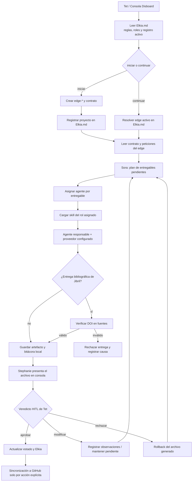
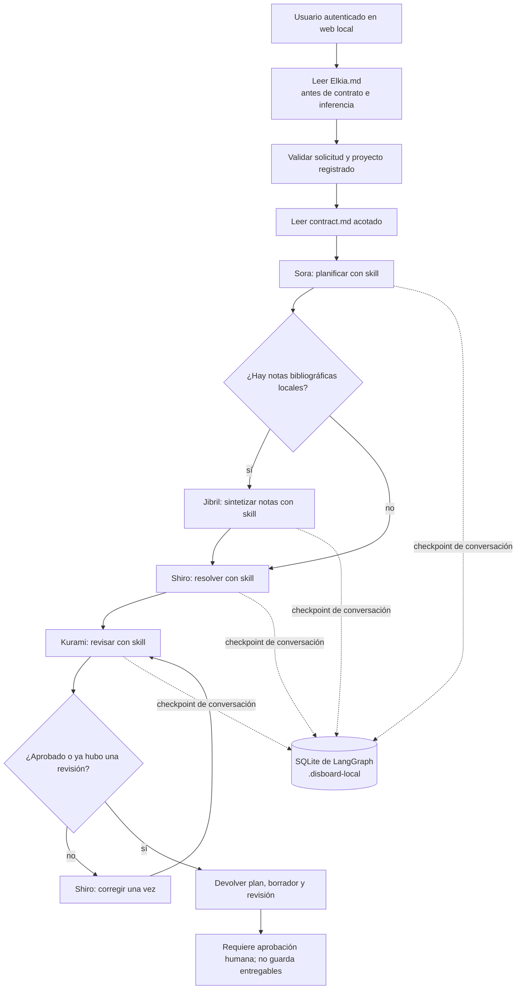

# 『 』 Disboard-NGNL: Ecosistema Científico Multiagente en Suniaster

Bienvenido a **Disboard-NGNL**, un ecosistema en desarrollo para coordinar proyectos de software, modelado científico y planificación mediante agentes. Puede ejecutarse desde consola o desde un servidor web local; el navegador de una tablet/laptop es un cliente del equipo que aloja el backend. Tet dirige el trabajo y conserva la aprobación humana (*Human-in-the-loop* - HITL).

Las propiedades de auditoría, reproducibilidad, compatibilidad multiplataforma, modularidad y protección de datos son requisitos de arquitectura. No deben interpretarse como certificaciones ya alcanzadas: el estado actual y los criterios verificables se mantienen en [docs/architecture.md](docs/architecture.md). En particular, Codespaces es un host remoto; no guarda en el disco físico del usuario ni tiene un canal implementado para transferir automáticamente sus entregables al repositorio de un laptop.

---

## 🏛️ 1. Arquitectura de Agentes y Roles en el Tablero

El repositorio opera bajo un estricto control de bajo consumo de tokens. Para evitar el desperdicio de contexto en las APIs libres, el núcleo inteligente divide sus capacidades en agentes principales y subagentes especializados con límites de autoridad y tareas quirúrgicas bien definidas:

### 👑 Soberanía del Tablero
*   **Tet (Tú / Autoridad Soberana):** Defines las reglas del juego, creas los directorios de trabajo y estableces las metas. Tienes el veredicto definitivo (HITL) sobre cada entregable. **Ningún cambio de código o hito pasa a producción en GitHub sin tu aprobación y firma digital (`Tet 🖋️`)**.

### 🎭 Consola de Orquestación e Interfaces de Presentación
*   **Stephanie Dola (Diplomática y Orquestadora Principal):** Tu interfaz interactiva directa y consola de comandos. Recibe tus instrucciones, controla las pausas de seguridad y ejecuta **rollbacks físicos** eliminando del disco duro archivos defectuosos si rechazas una jugada. **Su rol principal es coordinar la integración y edición contextualizada de resultados en narrativas, preprints, informes y diapositivas para la audiencia indicada**, con apoyo de los agentes técnicos y revisión final de Tet.
    *   **Fiel Nirvalen (Subagente de Dola / Asistencia Administrativa):** Apoya a Stephanie en auditorías de bitácoras e informes ejecutivos de progreso. Administra tu agenda académica en `AGENDAS_Y_CURSOS.md` y redacta borradores de correo seguros utilizando la base de conocimientos **`email.md`** para evitar la fuga de datos reales en prompts externos.

### 🧠 El Núcleo de Ejecución Técnico y Científico
*   **Sora (El Estratega / Project Manager):** Diseña la estrategia del proyecto, divide metas en hitos atómicos (`/plan`), gestiona el backlog global y balancea las cuotas libres de las APIs para evitar rate limits.
    *   **Izuna Hatsuse (Subagente de Sora / HPC e Ingeniería de Datos):** Extrae, limpia, valida y paraleliza bases de datos tabulares (CSV/Excel).
    *   **Jibril (Subagente de Sora / Descubrimiento Científico):** Realiza búsquedas bibliográficas avanzadas y minería de metadatos en **Crossref, OpenAlex y ORCID**. Cada referencia propuesta debe tener un DOI localizado al menos en una de las tres fuentes; solo se descartan las referencias sin verificación.
*   **Shiro (El Analista Lógico / Código y Precisión):** Responsable de la generación de código limpio en Python bajo metodología TDD, suites de pruebas unitarias robustas, modelado matemático y preprints técnicos.
    *   **Kurami Zell (Subagente de Shiro / Teoría y Restricciones):** Crítica adversarial interna. Desafía los cálculos de Shiro para detectar inconsistencias físicas o lógicas.
    *   **Clammy Zell (Subagente de Shiro / Alineación de Metas):** Asegura diplomáticamente que las simulaciones y diseños lógicos de Shiro concuerden estrictamente con los objetivos del contrato.

### Del concepto a los entregables del edge

Tet aporta la semilla y el contexto disponible: una pregunta, necesidad, idea central, datos, referencias o requisitos. Sora debe convertirlos en objetivos, hitos y criterios comprobables; los agentes especializados desarrollan evidencia, análisis, software y borradores; Kurami y Clammy revisan rigor y alineación; Stephanie integra el paquete según su destinatario. Las observaciones regresan como trabajo correctivo hasta que Tet apruebe el cierre. Si faltan datos o decisiones, los agentes deben hacer explícita la incertidumbre y pedir orientación en vez de completar huecos con invenciones.

La salida depende del propósito del edge: informe de avance o decisión para superiores, aplicación con pruebas e instrucciones, o manuscrito preparado para las normas de una revista. IA puede participar en la redacción y edición contextualizadas; herramientas locales deben encargarse de cálculos reproducibles, validaciones, pruebas, formato y procedencia cuando sea posible. El detalle del ciclo objetivo y la diferencia frente a las capacidades actualmente conectadas están en [docs/architecture.md](docs/architecture.md). La aprobación de Tet habilita la entrega dentro del flujo, pero no garantiza decisiones externas de superiores, revisores o revistas.

---

## 🔄 2. Diagrama de Flujo e Interacción del Sistema

El repositorio tiene dos superficies de agentes: la consola de proyectos (con revisión HITL de archivos) y el grafo local de LangGraph usado por la web (responde con borrador; no escribe archivos). Los diagramas muestran ambos flujos reales:



### Grafo web local de LangGraph



El SQLite de ese diagrama guarda únicamente checkpoints del flujo LangGraph: no es la base analítica compartida por los proyectos. Consola y web leen primero el contexto operativo de Elkia; luego usan el contrato del edge seleccionado. Elkia limita la selección web al registro activo y se actualiza con hitos de creación, revisión y decisiones HITL; los porcentajes no se inventan ni cambian sin evidencia contractual. El grafo carga la skill de cada rol activo y solo incorpora Jibril cuando hay notas locales; usa Ollama local y no persiste entregables. Las ocho skills del tablero (incluidos los subagentes) están catalogadas en [skills/README.md](skills/README.md). La distinción entre checkpoints y datos reutilizables entre edges, así como el alcance ya implementado y el flujo objetivo, está en [docs/architecture.md](docs/architecture.md).

Para mover archivos entre consola/Codespaces y el equipo personal existe un relay manual con SHA-256 sobre HTTPS y almacenamiento privado del host. Solo transfiere artefactos: no ejecuta agentes remotos ni guarda automáticamente resultados dentro del árbol `edge-*`. Requiere configurar la VPN/TLS y credenciales por separado; los pasos y límites están en [docs/LOCAL_WEB.md](docs/LOCAL_WEB.md).
---

## 🎮 3. Matrices de prioridades y peticiones libres

Al abrir `disboard_console.py`, Tet ve todos los proyectos activos registrados en `Elkia.md` distribuidos en una matriz Eisenhower, más los elementos cerrados. Cada cuadrante tiene color: Q1 rojo, Q2 amarillo, Q3 azul y Q4 gris. El cálculo usa la fecha objetivo del contrato y el porcentaje de avance de Elkia, sin gastar tokens:

* **Urgente:** fecha objetivo dentro de 7 días o vencida.
* **Importante:** avance inferior a 50%.
* Si falta fecha se considera no urgente; si falta avance, importante provisionalmente. `†` indica que Tet debe completar el dato.
* Los proyectos cerrados siguen visibles bajo **CERRADOS**.

La agenda general `AGENDAS_Y_CURSOS.md`, mantenida por Fiel Nirvalen, tiene otra matriz de colores con las mismas reglas. Al iniciar, Sora y Fiel sugieren automáticamente qué pendiente atender primero según Q1 → Q4; Tet conserva la decisión.

En el prompt principal Tet escribe una petición en lenguaje natural. Sora identifica si corresponde a un proyecto de la matriz, a crear uno nuevo, o a una acción de correo, informe, agenda, bibliografía u otra consulta. Si no hay un proyecto inequívoco, pide seleccionar un ID de la matriz. La petición se registra en el edge cuando corresponde y **los agentes la ejecutan**: generan un borrador/artefacto para revisión, atienden la agenda, redactan el correo o preparan el informe. `peticiones_tet.md` es la bitácora de solicitudes, no el resultado final.

Los nuevos edges conservan la plantilla contractual completa y admiten temas libres y combinados; ya no se elige ni se poda un módulo A–D. Si una solicitud cambia o crea objetivos, alcance o entregables, Sora propone un `contract.md` candidato siguiendo [contract-template.md](contract-template.md). Tet revisa el contrato y el artefacto producido; únicamente una aprobación explícita reemplaza el `contract.md` vigente. Los resultados quedan sujetos al veredicto HITL y las referencias bibliográficas propuestas no se activan sin revisión de Tet.

Tras aprobar un artefacto de proyecto, Sora puede proponer un porcentaje de avance y una siguiente acción basados en la evidencia. Tet debe autorizar esa actualización por separado para que se escriba en `Elkia.md` y afecte la matriz; rechazarla conserva el estado actual. Las fechas objetivo solo cambian al aprobar la propuesta contractual correspondiente.

Antes del enrutamiento con IA, la consola pregunta si Tet autoriza proveedores externos; la respuesta negativa limita el ciclo a Ollama local y falla claramente si no está configurado. Las notas y aportes privados tienen consentimiento separado. Solo las operaciones que requieren ejecución local determinista, como extraer texto de un PDF, se hacen sin LLM.

Para correo, la consola evita pasar el texto original al router. Fiel muestra una vista previa anonimizada (correos electrónicos, teléfonos, encabezados de contacto y enlaces se sustituyen localmente) y no continúa hasta que Tet confirme que tampoco quedan nombres u otros datos identificables. La respuesta se dirige a **Destinatario general**. Las respuestas aprobadas y las guías importadas se guardan en `.disboard-local/guia_respuestas_correo.md`, fuera de Git; `guia-correo` permite importar una guía Markdown de hasta 12 KB o registrar una respuesta manualmente y `subir-guia-correo "<ruta.md>"` permite importarla directamente. La guía también se revisa/anonimiza localmente antes de enviarse a la IA.

**Privacidad del equipo:** Los aportes y checkpoints de consola viven por defecto en `.disboard-local/`, excluido de Git; las revisiones y extracciones Markdown completas de PDF también se excluyen. Sin embargo, Codespaces es una máquina remota en la nube: para que los datos estén físicamente en el disco del usuario, debe ejecutar el repositorio en un equipo local. La consola usa Ollama por defecto en cada ciclo y requiere autorización explícita para proveedores externos; eso no cambia el hecho de que Codespaces aloja el workspace remotamente.

### 🏁 Esquema CONCLUIR
Se utiliza para realizar la revisión final del producto entregable (como la compilación de un preprint técnico para publicación):
1. Stephanie Dola y Sora inician una revisión integral de consistencia.
2. Con la autorización y configuración de proveedor correspondientes, Stephanie puede solicitar a un modelo IA apoyo editorial para revisar el entregable. La revisión debe preservar el significado y la evidencia, señalar incertidumbres y devolver cambios para inspección; **no garantiza ausencia de errores, alucinaciones ni aceptación por una revista o jefatura**.
3. Tet verifica las modificaciones frente a datos, fuentes, cálculos, criterios del contrato y requisitos vigentes del destinatario antes de aprobar una versión de entrega.

---

## 🛠️ 4. Inicio y ejemplos de entrada libre

Inicia la interfaz una vez desde la terminal:

```text
python3 disboard_console.py
```

Después se trabaja escribiendo solicitudes, no seleccionando comandos tácticos. Por ejemplo:

* “GRAPHOS: revisa la petición de Tet, formula objetivos y sugiere literatura inicial.”
* “Crea un proyecto nuevo para analizar colaboraciones entre institutos de investigación.”
* “Redacta un correo para solicitar los datos faltantes del proyecto DOIS.”
* “Prepara un informe general del avance y señala los bloqueos.”
* “Agenda una reunión de revisión para el 2026-10-20.”
* “GRAPHOS: revisa el PDF `/ruta/local/articulo.pdf` y propone referencias relacionadas.”
* “Aprueba en el proyecto GRAPHOS la referencia DOI 10.xxxx/ejemplo.”

El agente presenta los borradores y operaciones que cambian datos para aprobación de Tet. Un PDF se extrae localmente a Markdown y se conserva; la búsqueda externa de trabajos citantes requiere consentimiento específico. La aprobación de nuevas referencias también es explícita y por DOI.

### Trabajar desde una terminal local: Git y arranque

Estos comandos se escriben en la terminal del equipo (PowerShell, Terminal de macOS/Linux o terminal de Codespaces), no en el prompt interactivo de Disboard. Para trabajar sin terminal web, clona el repositorio en tu computadora: así los archivos quedan en ese equipo.

```bash
# Solo la primera vez: clonar y preparar el entorno
git clone https://github.com/Tlachino-M-FJ/Disboard-NGNL.git
cd Disboard-NGNL
python3 -m venv .venv
source .venv/bin/activate           # macOS/Linux
# Windows PowerShell: .venv\Scripts\Activate.ps1
python -m pip install -r requirements.txt

# Iniciar la consola de agentes desde la raíz del repositorio
python disboard_console.py
```

Comandos Git cotidianos (ejecutarlos en otra sesión de terminal, o después de salir de la consola con `salir`):

```bash
git status --short                  # ver archivos modificados
git diff                            # revisar cambios sin preparar
git pull --ff-only origin main      # traer cambios sin crear un merge inesperado
git add README.md                   # preparar un archivo específico
git diff --cached                   # revisar exactamente lo preparado
git commit -m "docs: add terminal and Git quickstart"
git push origin main                # publicar el commit de la rama main
git log --oneline -5                # consultar commits recientes
```

Antes de `git add -A`, revisa `git status`: ese comando prepara todos los archivos no ignorados del repositorio. Si trabajas en una rama propia, publica con `git push -u origin nombre-de-rama` en lugar de `git push origin main`.

Para pausar cambios sin perderlos o limpiar con cuidado:

```bash
git stash push -m "trabajo pendiente"   # apartar cambios temporalmente
git stash list                          # ver apartados
git stash pop                           # recuperar el apartado más reciente
git restore --staged -- ruta/archivo    # quitar un archivo del área de commit
git clean -nd                           # solo mostrar archivos no rastreados que se borrarían
git clean -fd                           # borrar esos archivos, tras revisar la vista previa
clear                                   # limpiar la pantalla de la terminal
```

`git restore -- ruta/archivo` descarta cambios locales de ese archivo. `git clean -fd` borra archivos no rastreados: revisa primero `git clean -nd`. **No ejecutes `git clean -fdx`**: también elimina archivos ignorados, incluidos `.venv/` y datos privados en `.disboard-local/`. Evita `git reset --hard` si no tienes una copia de tus cambios.

---

## 💻 5. Protocolo Especial para Wolfram Language

Para mantener la precisión matemática de la suite de cálculo de **Shiro** y **Kurami Zell** de manera transparente y gratuita:
1. El pipeline técnico multiagente generará el código simbólico ejecutable de Wolfram Language (con comentarios explicativos paso a paso) y lo guardará localmente en tu carpeta `src/`.
2. **Shiro desplegará y te entregará directamente el bloque de código limpio en la consola central**.
3. **Tus responsabilidades de juego:** Tomas el código entregado por Shiro, lo evalúas en tu entorno externo (**Wolfram Cloud** o **Wolfram Engine** local) para comprobar su correcto funcionamiento.
4. En consola, dictas tu veredicto HITL para aprobar el entregable simbólico, proponer modificaciones de variables o descartarlo.

---

## 🎨 6. Formatos y Plantillas Soportadas

El repositorio incluye plantillas simétricas en formatos **LaTeX (`.tex`)** y **Word/PowerPoint (`.docx` / `.pptx`)** dentro de la carpeta de recursos `docs/` para que Stephanie Dola aplique de forma automatizada las paletas de marca (Disboard Cyberpunk o SECIHTI Oficial):
*   **Preprints Científicos:** `preprint.tex` / `preprint.docx`
*   **Resúmenes Ejecutivos:** `summary.tex` / `summary.docx`
*   **Manuales de Procedimientos:** `manual.tex` / `manual.docx`
*   **Informes Técnicos de Avance:** `report.tex` / `report.docx`
*   **Resultados de Cómputo:** `results.tex` / `results.docx` (¡Nuevo!)
*   **Protocolos de Investigación:** `protocol.tex` / `protocol.docx` (¡Nuevo!)
*   **Presentaciones de Diapositivas:** `presentation.tex` (LaTeX Beamer) / `presentation.pptx` (PowerPoint)

Los informes Markdown/LaTeX y preprints ensamblados desde un manifiesto se generan sin IA con `disboard_reports.py`; los estilos de marca se aplican con `stephanie_stylist.py`. Para leer CSV/Excel/JSON y crear una tabla SQLite normalizada por criterios explícitos de Tet, consulta [edge-bases_de_datos/docs/data-schema.template.json](edge-bases_de_datos/docs/data-schema.template.json) y [docs/architecture.md](docs/architecture.md). Ese procesamiento valida columnas, tipos y claves localmente, sin enviar filas a proveedores de IA.

Para transcribir texto de PDF sin IA, desde el prompt de `python disboard_console.py` ejecuta `pdf <ID_PROYECTO> "<ruta/al/archivo.pdf>" [DOI-semilla]`. También está disponible directamente como `python disboard_pdf_to_markdown.py edge-mi-proyecto /ruta/articulo.pdf`. El resultado se guarda en `docs/bibliografia/pdf-<hash>.md` y el PDF se copia a `docs/bibliografia/fuentes/`. Con autorización de Tet, el mismo comando consulta OpenAlex por trabajos que citan el DOI semilla y deja propuestas para revisión de Jibril/Tet. PDF→Markdown no puede preservar fielmente diagramación, imágenes, tablas visuales ni texto escaneado; el PDF original se conserva como fuente canónica.

## 🖥️ 7. Tablero Web Local y privacidad

El despliegue recomendado es híbrido con fuente canónica en el laptop: el backend y los archivos persistentes viven en el laptop, y la tablet accede como cliente por TLS/VPN para cargar, ver y descargar documentos. El relay opcional mueve artefactos verificados entre Codespaces y el almacén privado del laptop, pero el workspace de Codespaces sigue siendo remoto y la integración al edge es manual. La arquitectura objetivo, las condiciones de privacidad, modularidad y auditoría están en [docs/architecture.md](docs/architecture.md); la instalación y límites operativos están en [docs/LOCAL_WEB.md](docs/LOCAL_WEB.md). La suite pasó localmente en Linux/Python 3.12 y en la primera ejecución de CI en Ubuntu; esa ejecución detectó fallos de portabilidad en Windows que están en corrección y requieren una nueva ejecución para certificarse. Consulta [docs/architecture.md](docs/architecture.md) para el estado de validación por plataforma.

### Navegadores recomendados

Para laptop/desktop, se recomienda la versión estable actual de **Chrome o Microsoft Edge**. **Firefox** también es una alternativa prevista para versiones actuales. En tabletas, usa **Safari actualizado en iPadOS** o **Chrome actualizado en Android**; Chrome en iPadOS también usa el motor WebKit del sistema. La interfaz usa HTML, CSS y JavaScript modernos y es adaptable a pantallas pequeñas; no ofrece soporte para Internet Explorer ni navegadores desactualizados.

El workflow de CI está configurado para ejecutar una prueba automatizada de interfaz en Chromium, Firefox y WebKit, incluyendo una vista estrecha de 390 px. También renderiza a SVG todos los bloques Mermaid del README y la arquitectura con Mermaid CLI; el chequeo estructural de IDs se mantiene como complemento. Esto comprueba el JavaScript y el diseño responsive con una API simulada y la sintaxis/renderizado de los diagramas; no certifica acceso desde dispositivos reales, TLS/VPN ni integración con Safari de iPadOS o Chrome de Android. Chrome y Edge usan Chromium, y Chrome en iPadOS usa WebKit, pero todavía se recomienda validar los dispositivos de destino antes de desplegar. Para acceso desde otro dispositivo, usa HTTPS con certificado válido y la red privada descrita en [docs/LOCAL_WEB.md](docs/LOCAL_WEB.md).

---

## 📜 8. El Juramento Soberano (Las Diez Reglas)

> *«...Las Diez Reglas rigen este mundo. Todos los conflictos, desde disputas territoriales hasta ecuaciones cuánticas, se resolverán a través de juegos. Declara tu jugada, mide tus cómputos y que comience la partida...»*
>
> **✦ ¡Aschente! ✦**
