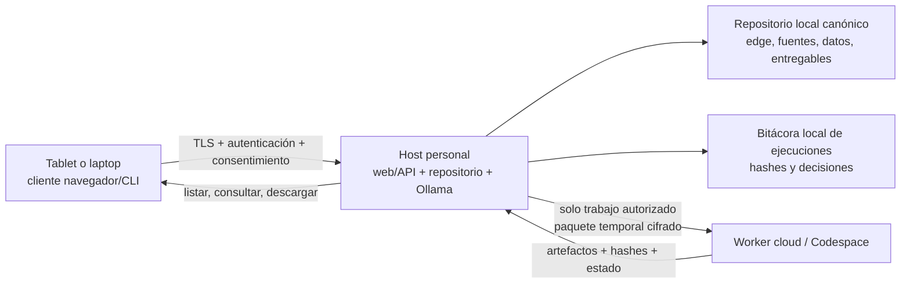
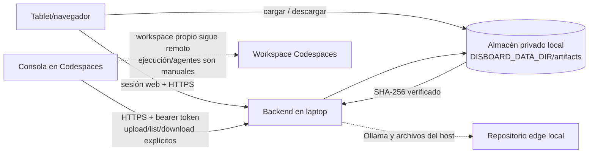
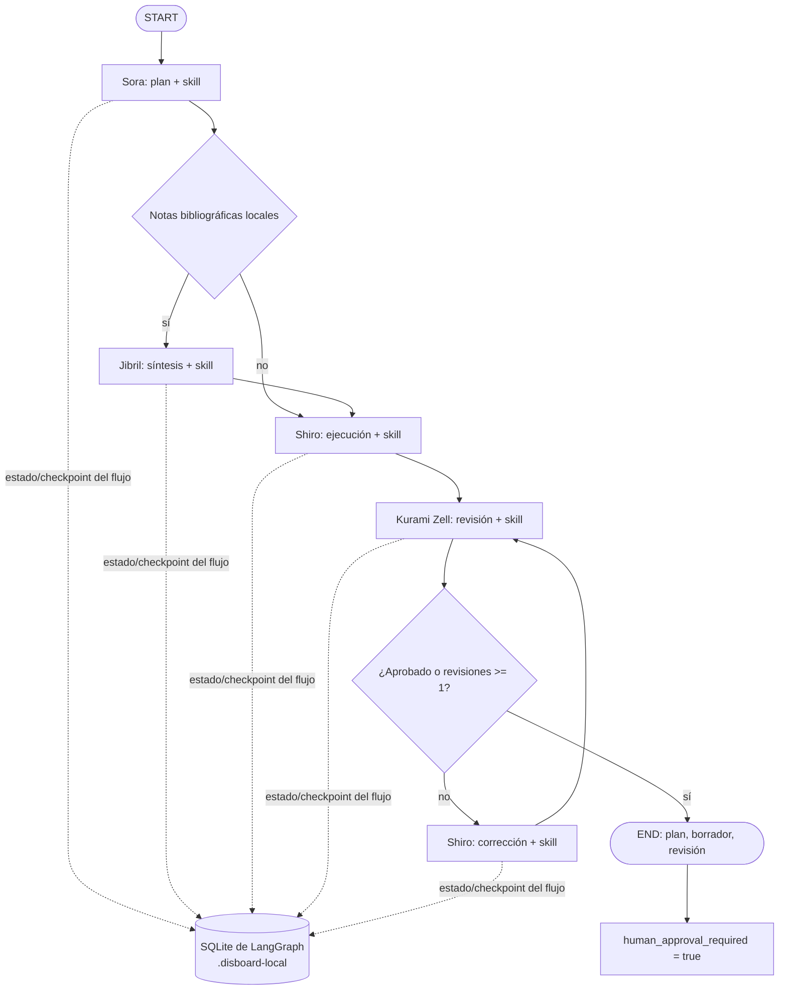
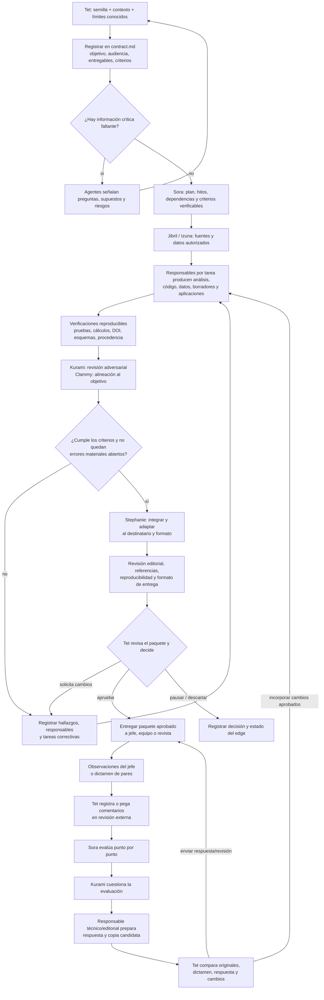
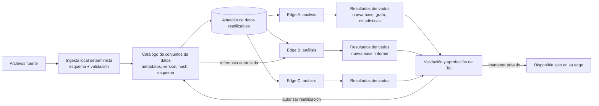
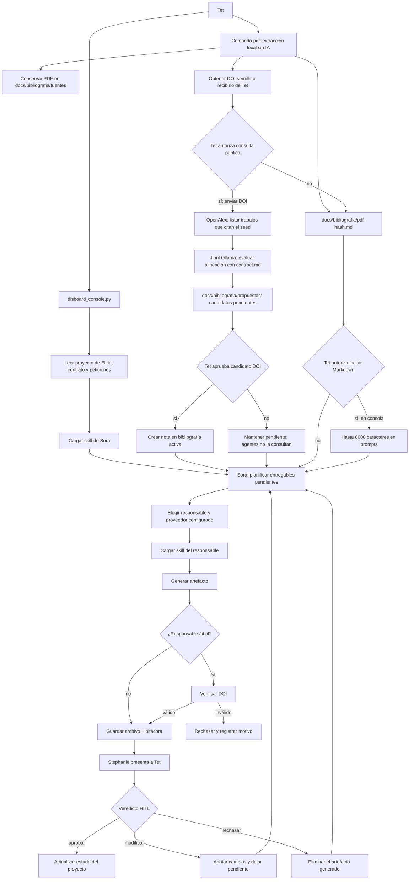

# Flujos de agentes y automatización local

## Cobertura de roles y skills

Los ocho agentes definidos en `README.md` tienen una instrucción reutilizable en `skills/<nombre>/SKILL.md`. Consola y grafo web leen primero las reglas, roles, estados y proyectos activos de `Elkia.md`; solo después consultan `contract.md` y peticiones del edge seleccionado. La consola actualiza en Elkia la fecha, estado, último movimiento y siguiente acción al crear, reanudar y resolver hitos HITL. El porcentaje se conserva si no existe evidencia para recalcularlo. `KuhakuPipeline` carga una skill por responsable del entregable; `DisboardAgentGraph` carga la skill antes de cada llamada LangGraph. Skills activas en el grafo web: Sora, Jibril (solo con notas bibliográficas locales), Shiro y Kurami. Izuna, Clammy, Fiel y Stephanie se usan en tareas de consola cuando aparecen como responsables.

LangGraph y `langgraph-checkpoint-sqlite` ya están declarados en `requirements.txt`. El grafo web se compila en `disboard_graph.py`, usa Ollama exclusivamente en localhost y conserva checkpoints bajo `.disboard-local/`. Devuelve un resultado sujeto a aprobación humana; no crea ni modifica entregables. La consola usa un pipeline separado que genera archivos y los presenta al veredicto HITL de Tet.

## Requisitos de calidad y despliegue: estado verificable

Los siguientes puntos son objetivos de arquitectura y condiciones de aceptación; no se deben presentar como garantías ya alcanzadas solo porque haya módulos que los apoyen:

| Cualidad | Criterio para considerarla satisfecha | Estado actual |
|---|---|---|
| Auditable | Cada ejecución registra versión de código, configuración no secreta, proveedor/modelo, hashes de entradas y salidas, decisiones HITL y resultados de pruebas, sin volcar datos confidenciales ni prompts completos al log. | Parcial: hay bitácoras, hashes de algunas fuentes y contadores; no existe aún un manifiesto único de ejecución para todos los flujos. |
| Reproducible | Entradas, esquema, transformaciones, dependencias, semilla aleatoria, parámetros y versión del código quedan identificados; resultados calculables se recrean mediante pasos documentados y pruebas. | Parcial: el importador tabular valida esquema y los reportes registran hashes, pero no hay paquete de reproducción universal. |
| Portable | La misma suite se instala y pasa en Windows y Linux con versiones de Python/dependencias soportadas; la web se usa desde una tablet como cliente de un host compatible, no como runtime Python en la tablet. | Aún no certificado: Linux pasó localmente y en CI; la primera ejecución en Windows detectó tres fallos de pruebas (hash de texto dependiente de saltos de línea, conexión SQLite abierta en la prueba y consola no UTF-8). Se corrigieron en el árbol de trabajo; falta una nueva ejecución Windows. |
| Modular | CLI/web/orquestador, almacenamiento, conectores IA, skills, ingestores y generadores intercambian contratos versionados; un módulo puede añadirse o reemplazarse con sus pruebas sin reescribir el núcleo. | Parcial: existe un registro explícito de plugins con contrato v1 y sustitución consentida para bloques compatibles; almacenamiento local es el primer adaptador integrado. Ingesta, proveedores y reportes aún no se ejecutan a través del registro. |
| Privacidad local | El equipo personal mantiene el repositorio canónico y los archivos persistentes. Acceso desde tablet se hace como cliente de ese host. Los modos cloud indican qué copias salen, a qué destino y cómo caducan. | No garantizado en Codespaces; el almacenamiento del workspace y sus archivos es remoto. |

El workflow de CI está configurado para validar el subconjunto de pruebas unitarias disponible en Linux y Windows, ejecutar una prueba de interfaz responsive con API simulada en Chromium, Firefox y WebKit, y renderizar con Mermaid CLI todos los diagramas de README y arquitectura a SVG. Esto no certifica automáticamente todos los formatos, modelos, dependencias opcionales, drivers, rendimiento, funcionamiento de Ollama en cada equipo ni dispositivos reales como iPadOS/Android. La portabilidad de Windows sigue pendiente de una ejecución CI posterior a las correcciones del árbol de trabajo; el nuevo job de Mermaid también requiere una ejecución CI para confirmar el renderizado.

## Despliegue híbrido y fuente canónica local

La meta acordada para el modo híbrido es que el repositorio del equipo personal sea la fuente canónica: documentos cargados desde una tablet/laptop conectada se escriben en el host personal; entregables aprobados se devuelven a ese repositorio y pueden consultarse/descargarse desde el dispositivo autorizado. El backend local debe exponer solo una interfaz autenticada por TLS y accesible mediante loopback o VPN privada.



La transferencia explícita de artefactos ya está implementada, pero el flujo híbrido **no está implementado de extremo a extremo**. El backend local ofrece una pestaña Archivos con carga/listado/descarga autenticados por sesión y un API relay protegido por token bearer; el cliente `disboard_relay.py` permite listar, transferir y verificar SHA-256 desde consola. Los archivos se guardan en `DISBOARD_DATA_DIR/artifacts/<edge>/`, fuera del árbol Git por defecto. La carga desde tablet llega a ese almacenamiento del host si el backend se ejecuta en el equipo personal. Si ese host es Codespaces, tanto la carga como los artefactos quedan en el entorno remoto.

El relay solo mueve archivos de hasta 50 MiB; **no empaqueta contexto, inicia agentes en Codespaces ni sincroniza automáticamente resultados con `edge-*/`**. Tet/operador decide los archivos y comandos; las descargas tienen nombre destino nuevo y verifican hash antes de publicar. Los artefactos textuales relayados pueden ofrecerse al pipeline de consola solo después de una confirmación explícita por ciclo, y se verifica su sidecar SHA-256 antes de incluirlos. Los archivos binarios no se añaden automáticamente a prompts. Para ejecutar el flujo en Codespaces y devolver resultados, conecta ambos equipos a la misma red privada y usa los comandos documentados en `docs/LOCAL_WEB.md`; el usuario aún debe decidir dónde integrar el artefacto en el edge.



Para ejecutar agentes en nube manteniendo al host como almacenamiento canónico, la implementación futura necesita un protocolo de jobs: permiso por ejecución y por archivo, lista de entradas y SHA-256, paquete de mínimo privilegio, canal TLS autenticado, estado/idempotencia, retorno validado de artefactos, verificación de hash, confirmación de escritura local, caducidad y limpieza verificable de staging. Los modelos/proveedores cloud pueden recibir contenido según su propia política; VPN/TLS protegen el transporte, no vuelven local el cómputo ni garantizan borrado en todos los sistemas externos. El relay actual únicamente devuelve archivos al almacén privado local: no sincroniza el workspace ni garantiza que todo resultado de Codespaces se haya eliminado.

### Diseño modular por bloques

El núcleo deberá depender de interfaces estables, no de implementaciones concretas:

1. **Edge y ciclo de trabajo:** contrato, estados, tareas, observaciones externas, aprobaciones e historial.
2. **Artefactos y almacenamiento:** guardar/listar/leer/versionar/verificar hash; backends local y relay usan la misma interfaz, con configuración explícita.
3. **Ingestores:** PDF, CSV/XLSX/JSON, bases de datos y formatos futuros convierten fuentes en artefactos descritos mediante metadatos comunes.
4. **Transformadores y analizadores:** operaciones deterministas (normalización, cálculos, grafos, estadísticas) tienen parámetros y pruebas; se separan de inferencia IA.
5. **Agentes y proveedores:** interfaz de inferencia intercambiable con capacidades declaradas (local/cloud), límite de datos, modelo y política de privacidad; skills no acoplan el orquestador a un proveedor.
6. **Generadores de entregables:** informe, aplicación, manuscrito y presentación se implementan como módulos reemplazables por formato y audiencia.
7. **Superficies de interacción:** consola, web local, tablet y worker cloud llaman los mismos casos de uso; no implementan reglas de negocio duplicadas.

Cada módulo nuevo o sustituto debe declarar `id`, versión semántica, versión de contrato, entradas/salidas tipadas, permisos requeridos, dependencias, errores explícitos y pruebas de conformidad. El registro v1 carga únicamente entradas activas en `disboard_plugins.json`, solo permite módulos bajo `disboard_ext_`/`disboard_ext.`, y requiere `replace: true` para sustituir una implementación ya registrada. La configuración de ejemplo no activa extensiones. La importación ejecuta código Python: la lista permitida es una protección contra descubrimiento accidental, no una frontera de seguridad para plugins no confiables. Actualmente está conectado el bloque de almacenamiento; un adaptador solo debe sustituirse si pasa las pruebas del contrato y declara migración cuando cambia el formato persistido. La futura integración de ingestores, proveedores y generadores sigue pendiente.

### Auditoría y reproducción de ejecuciones

El manifiesto de una ejecución futura debe registrar: `run_id`, edge y estado; commit/tag del código; versiones de Python, SO, dependencias y módulos; hashes y procedencia de entradas; parámetros, esquema y semilla aleatoria; proveedor/modelo y configuración no secreta; aprobaciones/consentimientos; artefactos producidos y sus hashes; pruebas y resultados; errores y decisión final de Tet. Por privacidad, no registra prompts, claves, contenido de datos ni dictámenes completos en la bitácora general. Los documentos de revisión se guardan aparte con control de acceso. Datos externos o generación no determinista de IA se etiquetan como tales y no se presentan como exactamente reproducibles; se conserva la respuesta aprobada y metadatos de llamada cuando la política lo permita.

### Matriz mínima de compatibilidad

| Cliente/host | Código y agentes | Almacenamiento canónico | Condición |
|---|---|---|---|
| Windows laptop | Consola/web local, Python y Ollama si son compatibles con el hardware/modelo | Disco local del laptop | Instalador/configuración y CI deben probar rutas/permisos Windows. |
| Linux laptop | Consola/web local, Python y Ollama | Disco local del laptop | Ruta recomendada actualmente para pruebas del repositorio, pero no equivale a soporte certificado de todas las dependencias. |
| Tablet | Navegador responsive, sin ejecutar el backend Python | Host laptop al que se conecta por TLS/VPN | Permisos de usuario; las cargas viajan al host, no se guardan en el almacenamiento privado del navegador. |
| Codespaces | Desarrollo y ejecución cloud de código/agentes | Workspace Codespaces remoto; artefactos seleccionados pueden transferirse manualmente al almacén local | Nunca describir el workspace como almacenamiento personal; transferencia requiere relay, TLS, token y autorización. |

## Grafo LangGraph de la web



El ruteo a Jibril depende de la presencia de notas locales, no de una llamada de IA. La revisión permite como máximo una corrección. El flujo no invoca agentes sin una etapa asignada ni envía datos a proveedores remotos.

El selector web enumera solo los edges activos declarados en la tabla maestra de `Elkia.md`; un directorio `edge-*` sin registro no se ofrece como proyecto. La entrada sin edge también carga las reglas y el registro global, pero no incluye ningún contrato.

**Importante:** este SQLite es almacenamiento de control de LangGraph (estado y checkpoints de ejecuciones), no es una base de datos de investigación ni un repositorio compartido entre proyectos `edge-*`. La web tampoco consulta actualmente las bases SQLite de los edges.

## Ciclo de vida deseado de un edge: de la semilla a la entrega

La meta de Disboard-NGNL no es limitarse a ejecutar una orden puntual o ensamblar un documento. Tet aporta una semilla (problema, idea central, hipótesis, datos, referencias o una combinación), además del contexto y los criterios que conozca. El equipo de agentes debe convertirla en un plan de trabajo verificable, desarrollar y corregir sus tareas en ciclos, producir los entregables que correspondan al tipo de edge y preparar una versión revisable para su destinatario. Tet conserva la autoridad para aclarar el alcance, aceptar cambios y aprobar el cierre.



Este ciclo es el **objetivo arquitectónico**, no una afirmación de que el repositorio ya orquesta automáticamente todas sus etapas. La consola actual lee contrato y peticiones, planifica con Sora, genera entregables con agentes asignados y permite a Tet revisar el resultado. También dispone de un paso de conclusión editorial. Sin embargo, no mantiene todavía un backlog de hallazgos común y persistente que enrute automáticamente cada observación al agente correcto, ni comprueba de extremo a extremo que todos los criterios de aceptación de cada tipo de proyecto se hayan satisfecho. El grafo web es aún más acotado: produce una respuesta en memoria con como máximo un ciclo de corrección y no genera ni persiste un paquete de entregables.

Para realizar el objetivo de forma confiable, cada tarea debe registrar al menos su responsable, entradas aprobadas, resultado esperado, evidencia de verificación, estado y observaciones de revisión. Las correcciones deben convertirse en tareas trazables, no limitarse a pedir al modelo que “pula” el texto. Cuando falte información o haya decisiones científicas, legales o de alcance que no puedan inferirse de la semilla, los agentes deben formular preguntas o declarar supuestos; no inventar autorización ni evidencia.

Los paquetes varían según su audiencia: un informe ejecutivo para superiores prioriza decisión, resultados, riesgos y anexos; una aplicación necesita código, pruebas, instrucciones y materiales reproducibles; un artículo necesita pregunta y contribución delimitadas, métodos, resultados, limitaciones, fuentes verificables, declaración de datos/código y adecuación a las guías vigentes de la revista. Los agentes pueden redactar, integrar y revisar estos documentos con IA usando el contexto autorizado; las transformaciones, estadísticas, pruebas, compilación y control de procedencia deben automatizarse de forma determinista siempre que sea posible. La aprobación de Tet es requisito del flujo local, pero ni ella ni la revisión de agentes pueden garantizar que un superior acepte un informe o que una revista acepte un artículo.

En la consola, **Continuar** acepta instrucciones libres y las registra en `docs/peticiones_tet.md`; Sora interpreta la petición y la contrasta con `contract.md`. Si requiere crear o cambiar el alcance, usa IA para producir una copia candidata conforme a `contract-template.md`; la consola valida las secciones, mantiene intacto el contrato activo y solicita aprobación de Tet antes de reemplazarlo. Peticiones de ejecución cubiertas por el contrato vigente continúan hacia los entregables existentes. El menú también permite agregar archivos de texto/código/datos al área local privada; su contenido solo se adjunta a los prompts después de consentimiento explícito de Tet. Cada ciclo pregunta por separado antes de enviar el contrato y las peticiones a proveedores externos; por defecto usa Ollama local y falla cerrado si no está configurado. La conclusión editorial también pide consentimiento antes de enviar el documento a un proveedor externo. Un PDF bibliográfico se procesa por la ruta PDF existente; toda referencia DOI incluida en una propuesta se verifica contra Crossref, OpenAlex u ORCID y permanece pendiente de aprobación de Tet. Las observaciones de una jefatura o de pares tienen una acción separada: Sora las evalúa punto por punto, Kurami audita la evaluación, el responsable prepara una carta y una copia candidata usando solo Ollama; los artefactos quedan pendientes de Tet y nunca sobrescriben el original automáticamente. Los dictámenes y propuestas se guardan por defecto en `docs/revisiones/`, con permisos privados y exclusión de Git.

Al iniciar la consola se presenta una matriz de prioridades calculada localmente, sin inferencia de IA: fecha objetivo a 7 días o menos (o vencida) marca urgencia y avance inferior a 50% marca importancia. Se ordena por fecha y avance. Sin ambas métricas un edge se muestra como no clasificado; no se inventan plazos ni porcentajes.

## Flujo multi-edge de datos reutilizables

El objetivo de datos es que un edge pueda producir un conjunto de datos o un análisis reutilizable y que otros edges autorizados lo consuman como entrada, generando nuevas bases derivadas, grafos, estadísticas o informes. El almacén de datos y sus metadatos son independientes de los checkpoints de LangGraph y del ciclo de aprobación de entregables:



Este diagrama expresa la arquitectura objetivo, no una capacidad completa ya conectada. Hoy `edge-bases_de_datos/src/disboard_data.py` puede leer CSV, Excel o JSON y crear/validar una base SQLite para una ejecución concreta, según el esquema indicado por Tet. Todavía no hay catálogo compartido, permisos entre edges, registro de versiones/procedencia ni conectores para que otros edges descubran y consuman esos resultados. Por tanto, la implementación actual es una base útil para la ingesta local; no debe asumirse que los edges ya comparten automáticamente una base.

Al evolucionar a ese flujo, cada conjunto deberá tener esquema, identificador y versión, hash de integridad, edge de origen, fuentes/procedencia, permisos explícitos y estado de aprobación. Los resultados derivados deberán referenciar sus entradas y parámetros para que las estadísticas, grafos y nuevas bases puedan reproducirse. La IA puede ayudar a interpretar resultados, pero la lectura, validación, transformaciones declaradas y cálculo estadístico deben permanecer automatizables sin IA cuando sus reglas estén especificadas.

## Ciclo de la consola de proyectos



## Ruta determinista de datos e informes

Las operaciones tabulares ordinarias no necesitan IA. `edge-bases_de_datos/src/disboard_data.py` lee CSV, XLSX/XLS o JSON, aplica aliases y tipos declarados en un esquema JSON, rechaza columnas inesperadas (salvo `allow_extra: true`), verifica requeridos y claves primarias, y escribe una tabla SQLite. El archivo fuente no se modifica. `--report` escribe un resumen JSON con conteos y hash, sin copiar registros. El contenido del esquema lo decide Tet; el programa no inventa equivalencias de columnas.

La lectura actual carga cada archivo en memoria; es adecuada para datos que caben en RAM. Para archivos mayores hace falta ampliar el proceso con lectura por lotes y validación incremental antes de aplicarlo a producción.

Ejemplo desde la raíz del repositorio:

```sh
python edge-bases_de_datos/src/disboard_data.py \
  /ruta/privada/observaciones.csv \
  --schema edge-bases_de_datos/docs/data-schema.template.json \
  --database /ruta/privada/observaciones.sqlite3 \
  --report /ruta/privada/validacion.json
```

Edita una copia del esquema para ajustarlo a las columnas, aliases, tipos, campos requeridos y clave primaria aprobados por Tet. Se requiere `--overwrite` para reemplazar una tabla que ya existe.

Para informes y preprints, `disboard_reports.py` consume un manifiesto JSON del proyecto y puede producir Markdown o LaTeX; `--pdf` compila con `latexmk` si está instalado. La utilidad registra hashes de fuentes y limita las tablas CSV incluidas. Es un ensamblador sin IA: la redacción científica y la selección de resultados deben ser validadas por Tet antes de incorporarlas al manifiesto.

## Ahorro de IA y límites actuales

- Lectura tabular, normalización por esquema, tipado, validación, escritura SQLite, hashes y ensamblado de informes son deterministas y locales.
- LangGraph conserva IA en planificación, síntesis opcional de notas, ejecución y revisión crítica. El ciclo omite Jibril cuando no existen notas y limita las correcciones a una.
- El grafo web no procesa archivos cargados desde la interfaz ni genera documentos en disco; para esos resultados se usa la ruta local de consola y herramientas deterministas.
- La consola permite convertir un PDF a Markdown por página sin IA (`pdf <edge> <ruta>`). Antes de enviar notas a proveedores configurados, pregunta a Tet; por defecto no las incluye en prompts. El Markdown conserva el texto que `pypdf` puede extraer, no la representación visual completa. El PDF original se mantiene como fuente canónica.
- Con permiso explícito, la búsqueda de citantes envía solo el DOI semilla a OpenAlex. Jibril revisa localmente la alineación de los metadatos/abstracts con el contrato del edge; las propuestas permanecen aisladas y solo se pasan a notas activas mediante una aprobación DOI de Tet. Crossref puede ofrecer metadatos y conteos, pero OpenAlex es la fuente usada para enumerar citantes.
