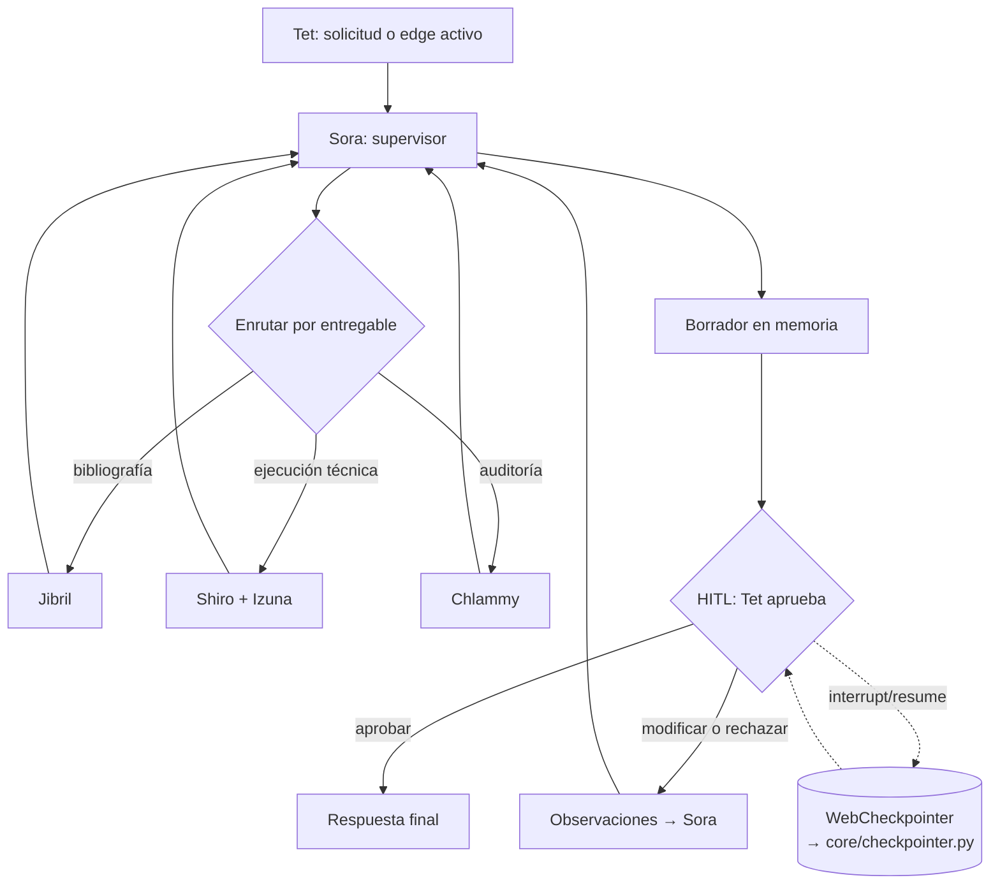

# Arquitectura de Disboard-NGNL

**Versión:** 1.0.0
**Ecosistema:** Disboard-NGNL · Suniaster Engine

## 1. Visión general

Disboard-NGNL es un marco multiagente para desarrollo de software, investigación
científica y planificación. Opera bajo la soberanía de **Tet** (el usuario)
mediante un bucle HITL con firma HMAC-SHA256, orquestado por **Stephanie Dola**
y enrutado por **Suniaster**.

### Principios rectores

- **Auditabilidad:** cada paso del grafo registra eventos en `logs/graph_trace.jsonl`.
- **Reproducibilidad:** semillas, versiones de modelos y hashes quedan en `core/checkpointer.py`.
- **Spec-First & TDD:** ningún código se escribe sin `spec.md` aprobado y pruebas.
- **Doubt-Driven Review:** Chlammy ejerce revisión adversarial antes del veredicto de Tet.
- **Privacidad local-first:** operaciones sensibles se ejecutan en el host.

## 2. Diagrama de flujo del grafo LangGraph

El grafo web vive en `web/graph.py` y sigue el patrón supervisor. La aprobación
HITL se gestiona con `interrupt()` y `WebCheckpointer` (que delega en
`core/checkpointer.py`).

## 3. Componentes

| Componente | Responsabilidad |
|---|---|
| `core/` | Tipos compartidos: `Edge`, `Contract`, `Log`, `Artifact`, `HITL`, `Checkpointer`, `Plugins`, `OverallState`. |
| `elkia/` | Registro de edges, reglas, estado y dashboard táctico. |
| `suniaster/` | Enrutamiento de modelos (`SuniasterRouter`) y actualización de proveedores (`SuniasterUpdater`). |
| `agents/` | Código de cada agente (Sora, Chlammy, Shiro, Izuna, Dola, Fiel, Jibril). |
| `skills/` | Instrucciones de rol de cada agente (`SKILL.md`) y metodologías. |
| `console/` | Consola HITL con archivos (`main.py`, `commands.py`, `presentation.py`). |
| `web/` | Servidor FastAPI, grafo LangGraph, dashboard HTML y plantillas. |
| `privacy/` | Filtros de privacidad y política de prompts. |
| `tools/` | Utilidades: reportería, catálogo de datos, PDF, document generator, STT/TTS. |
| `templates/` | Plantillas Jinja2 para LaTeX, Markdown y Marp. |
| `disboard_ext/` | Plugins de extensión (almacenamiento local de artefactos). |

## 4. Flujo de datos

1. Tet → idea semilla → `core/edge.py` crea el edge.
2. Sora → plan → `core/contract.py` → Tet aprueba → `core/hitl.py` firma.
3. Suniaster → asigna modelo por agente → `suniaster/router.py`.
4. Shiro / Jibril / Izuna → ejecutan → `core/artifact.py` registra.
5. Chlammy → audita → `core/log.py` registra.
6. Tet → veredicto HITL → `core/hitl.py` → cierre o rollback.

## 5. Privacidad

- Filtros centralizados en `privacy/filters.py` (con `PRIVACY_STRICT`).
- Política operativa en `privacy/prompts_policy.md`.
- Documento arquitectónico en `docs/privacy.md`.
- Fiel Nirvalen reexporta el filtro central en `agents/fiel_nirvalen/privacy_filter.py`.

## 6. Plataformas / núcleo

| Elemento | Rol | Analogía NGNL |
| :--- | :--- | :--- |
| **Elkia** | Entorno de trabajo (consola, web, base de datos) | Reino de Elkia |
| **Suniaster** | Enrutador y actualizador de modelos de IA | Guardián del Exeed Registry |

## 7. Estructura del repositorio

Ver §6 del `README.md` para el árbol completo.
