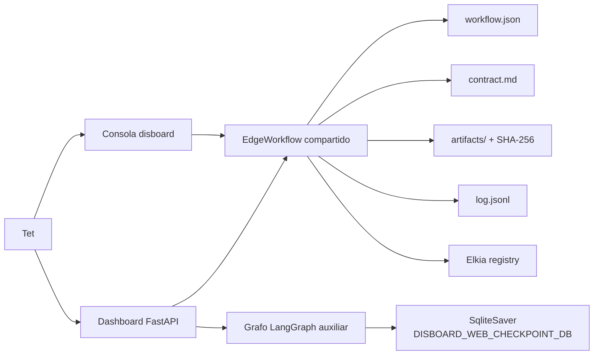

# Arquitectura de Disboard-NGNL

## Alcance actual

El usuario **Tet** trabaja mediante dos interfaces sobre el mismo workflow por
edge: la consola (`disboard work`) y el dashboard (`web/server.py`). Ambas
persisten solicitudes, plan, referencias, entregables, aprobaciones y artefactos
en `edges/<id>/`. El grafo LangGraph es un motor auxiliar separado; no es la
persistencia del workflow del dashboard.

Los agentes web actuales usan implementaciones deterministas y scaffolds. La
configuración de proveedores de Suniaster existe, pero el workflow web todavía
no inyecta esos modelos en Sora o Shiro. No se debe presentar generación con LLM,
ejecución automática de código o auditoría avanzada como capacidades activas.

## Interfaces y persistencia

El diagrama del proceso HITL y el detalle de agentes están en §2 de `README.md`.

## Seguridad y auditoría

- Las aprobaciones de plan, bibliografía, entregables y cierre se firman con
    HMAC-SHA256 y `TET_SIGNING_KEY` (mínimo 32 bytes aleatorios).
- Al continuar y cerrar, el workflow verifica las firmas y recalcula SHA-256 de
    los artefactos activos. Las rutas de artefactos se restringen al directorio del
    edge; un nombre ya usado no sobrescribe bytes previos.
- Las conexiones remotas requieren Basic Auth y HTTPS. Detrás de un proxy,
    `DISBOARD_WEB_TRUST_PROXY_HEADERS` solo se habilita cuando el origen está
    aislado y el proxy de confianza reenvía `X-Forwarded-Proto`.
- Las mutaciones rechazan orígenes ajenos y solicitudes `cross-site`; el
    middleware añade cabeceras CSP, `nosniff`, `DENY` y no-cache.
- Los logs son append-only por el flujo normal, no criptográficamente
    inmutables ante quien controle el host. La aplicación no cifra archivos ni
    checkpoints en reposo; el sistema operativo y los backups son parte del límite
    de confianza.
- El filtro `privacy/filters.py` solo protege llamadas que lo invocan. La búsqueda
    libre actual filtra la consulta antes de Crossref; no es un DLP universal.

## Módulos

| Módulo | Responsabilidad actual |
|---|---|
| `core/` | Edge, contrato, firmas HMAC, logs, artefactos y plugins compartidos. |
| `web/workflow.py` | Transiciones HITL persistentes y coordinador común de consola/web. |
| `web/security.py` | Autenticación remota, HTTPS/proxy, CSRF y cabeceras. |
| `web/` | API FastAPI, dashboard Jinja2 y grafo LangGraph auxiliar con `SqliteSaver`. |
| `console/` | CLI, menú interactivo y operaciones sobre el mismo `EdgeWorkflow`. |
| `elkia/` | Registro local de edges, reglas y métricas tácticas. |
| `agents/` | Lógica determinista actual y conectores bibliográficos/de ejecución. |
| `suniaster/` | Configuración y adaptadores de modelos; no conectados al workflow web actual. |
| `privacy/` | Filtros explícitos y política de uso de prompts. |
| `disboard_ext/` | Plugin del almacén local de artefactos. |

Ver [`docs/manual.md`](manual.md), [`docs/privacy.md`](privacy.md) y §2 de
[`README.md`](../README.md) para operación, seguridad y diagramas detallados.
